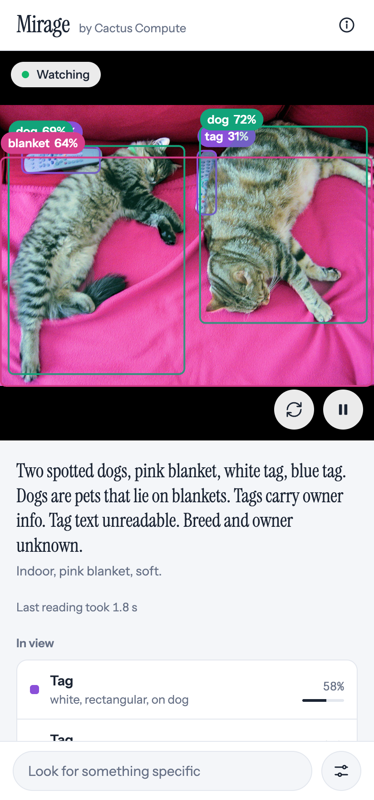
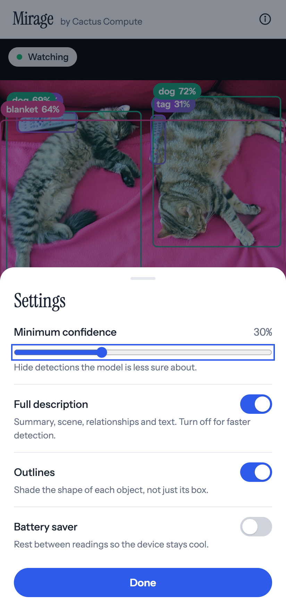
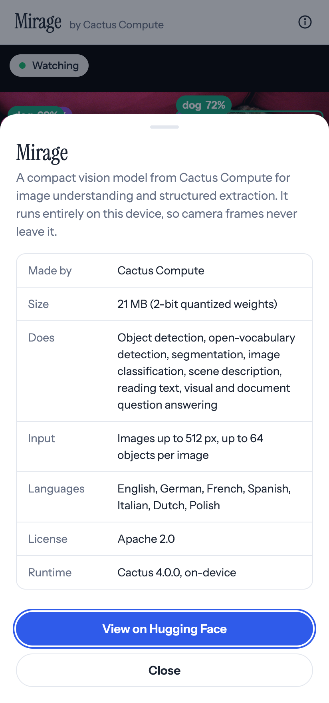
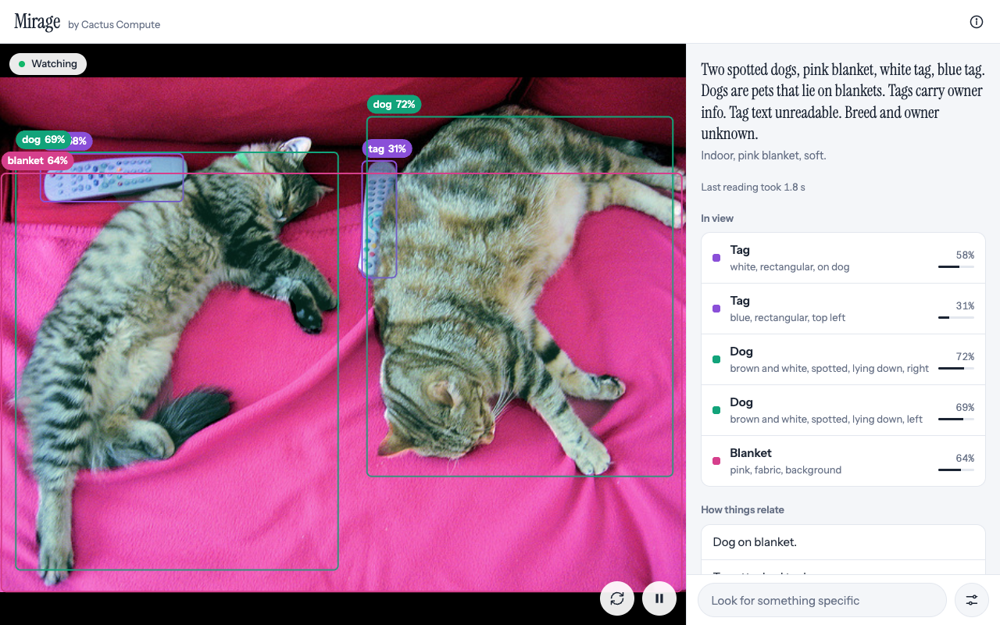

# Mirage Vision Demo

Point your camera at something and see what it is. This app runs [Mirage](https://huggingface.co/Cactus-Compute/mirage), a 21 MB vision model from [Cactus Compute](https://cactuscompute.com), live on your camera. It draws boxes and outlines around objects and describes the scene in plain English.

Everything runs on the device. No camera frames are uploaded anywhere.

## Download

| Platform | File | Notes |
|---|---|---|
| Android (64-bit ARM) | [**Mirage.apk**](https://github.com/thakurcoderz/mirage-vision-demo/releases/latest/download/Mirage.apk) | Allow "Install unknown apps" for your browser or file manager. Signed with a debug key. |
| macOS (Apple Silicon) | [**Mirage_0.1.0_aarch64.dmg**](https://github.com/thakurcoderz/mirage-vision-demo/releases/latest/download/Mirage_0.1.0_aarch64.dmg) | Not notarized. Right-click the app and choose **Open** the first time. |

All builds are on the [Releases page](https://github.com/thakurcoderz/mirage-vision-demo/releases).

## Screenshots

<p>
  
  
  
</p>



These are real Mirage outputs for a test photo. Mirage isn't perfect: here it calls the two cats "dogs" and the remote controls "tags".

## Features

- **Live object detection** with boxes, labels, confidence scores and shaded outlines of each object's shape.
- **Scene description** in plain English, plus the setting, how objects relate ("dog on blanket"), and any text it can read.
- **Object list** with each object's colour, material and position, colour-matched to its box on camera.
- **Look for something specific.** Type words like `cup, keys` to steer what the model looks for.
- **Settings:** minimum confidence, full description or faster objects-only mode, outlines on/off, battery saver.
- **About screen** with the model's details and a link to its Hugging Face page.
- **Kind to batteries.** The model only runs when the view changes, rests between readings in battery-saver mode, and releases the camera when the app is in the background.
- **Front/back camera switch** and pause.

## About the model

| | |
|---|---|
| Model | [Cactus-Compute/mirage](https://huggingface.co/Cactus-Compute/mirage) |
| Made by | Cactus Compute |
| Size | 21 MB (`mirage.cact`, 2-bit quantized) |
| Can do | Object detection, open-vocabulary detection, segmentation, image classification, scene description, reading text, visual and document question answering |
| Input | Images up to 512 px, up to 64 objects per image |
| Languages | English, German, French, Spanish, Italian, Dutch, Polish |
| License | Apache 2.0 |
| Runtime | [Cactus 4.0.0](https://huggingface.co/Cactus-Compute/cactus) |

## Performance

Time for one reading, as measured while building this demo:

| Device | Full description | Objects only |
|---|---|---|
| Apple Silicon Mac | ~0.13 s | ~0.11 s |
| Android, Snapdragon 710 (2018) | ~3 s | ~2.4 s |

Almost all of that time is the model. Passing a frame from the camera to the model adds about 50 ms.

## How it works

```
camera (WebView getUserMedia)
  → frame scaled to ≤512 px, RGBA from a canvas
  → Tauri command `detect` (raw bytes on desktop, base64 on Android)
  → Rust: RGBA → RGB, calls cactus_describe() from the static Cactus runtime
  → Mirage JSON: objects (box, outline, score, attributes), scene, relations, text, summary
  → UI draws boxes on a canvas over the video and writes the reading panel
```

- `src-tauri/src/lib.rs` is the whole native side: it loads the embedded weights once and exposes one `detect` command.
- `ui/index.html` is the whole interface. It's plain HTML, CSS and JavaScript, with no bundler.
- `vendor/` holds the prebuilt Cactus runtime (`libcactus.a` for macOS arm64 and Android arm64, `cactus.h`) and the Mirage weights, which are compiled into the app with `include_bytes!`.

## Build from source

Requirements: Rust, Node.js, and for Android the Android SDK + NDK and a JDK.

```sh
npm install

# Desktop (macOS Apple Silicon)
npx tauri dev            # run
npx tauri build          # .app and .dmg in src-tauri/target/release/bundle/

# Android (arm64)
export ANDROID_HOME=~/Library/Android/sdk NDK_HOME=$ANDROID_HOME/ndk/<version>
rustup target add aarch64-linux-android
npx tauri android build --apk --target aarch64
# then sign the APK, e.g. with your debug keystore:
#   zipalign -f 4 <unsigned.apk> aligned.apk
#   apksigner sign --ks ~/.android/debug.keystore --ks-pass pass:android --out Mirage.apk aligned.apk
```

Run the tests, which load the real model:

```sh
cd src-tauri && cargo test
```

To add another platform, download its `libcactus.a` from the [Cactus release](https://huggingface.co/Cactus-Compute/cactus/tree/main/releases/4.0.0) into `vendor/<platform>/` and add the target to `src-tauri/build.rs`.

## Credits

- Mirage model and Cactus runtime by [Cactus Compute](https://cactuscompute.com), Apache 2.0 (see `vendor/LICENSE`).
- App built with [Tauri 2](https://tauri.app).
